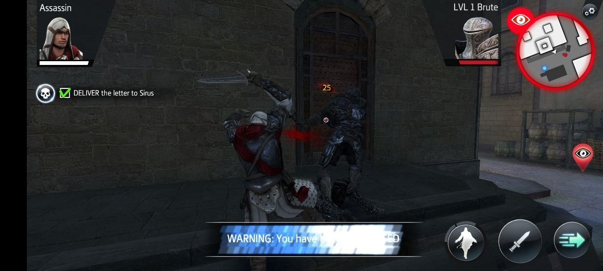
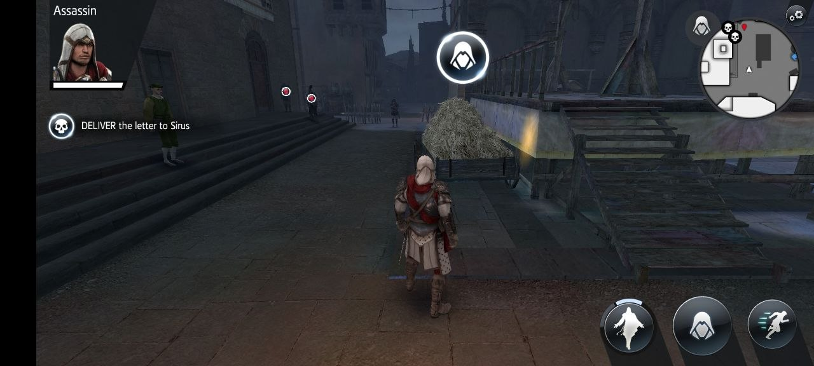

# Assassin's Creed Identity - 100% Offline Standalone Release

<p align="center">
  
  
</p>

Play the complete **Assassin's Creed Identity** (v2.8.2) anywhere, 100% locally on your Android device — **no PC, Mac, external server, or Wi-Fi required!**

---

## 📦 What's Inside This Bundle

| File / Folder | Description |
| :--- | :--- |
| **`ACIdentity_Game.apk`** | Game client pre-patched for on-device localhost (`127.0.0.1:8080`). Disables obsolete server signature checks, Play license checks, and forces ETC2 rendering. |
| **`ACIdentity_CompanionServer.apk`** | Lightweight Android companion app running a background foreground service that simulates the Ubisoft Acier server on `127.0.0.1:8080`. |
| **`GameData_Cache/`** | Complete 1.5 GB asset cache (all 104 game data files, high-res textures, Italian Renaissance maps, audio, and character models). |
| **`install.sh`** | 1-click automatic installer for macOS and Linux (via ADB). |
| **`install.bat`** | 1-click automatic installer for Windows (via ADB). |

---

## 🎯 Authentic Mission Objectives & Real Storyline

Unlike previous generic placeholders, every mission features authentic story setups, custom spawns, and distinct gameplay objectives:

### 🎓 Animus Training (Montreal / Monteriggioni)
1. **Tutorial 1 - Interaction**: Approach and talk to the Doctor in the town square. Non-combat interaction objective.
2. **Tutorial 2 - Free Running**: Rooftop parkour obstacle course across Monteriggioni rooftops.
3. **Tutorial 3 - Combat**: 1-on-1 sparring session with a training partner under instructor supervision.
4. **Tutorial 4 - Skills**: Combat skill dummy brute.
5. **Tutorial 5 - Eagle Vision**: Locate an undercover spy concealed within a crowd of civilians.
6. **Tutorial 6 - Air Assassination**: Perch on a high rooftop ledge directly above a sentry and trigger the Air Assassination jump takedown.
7. **Tutorial 7 - Stealth Assassination**: Approach a patrolling guard from behind cover for a silent backstab.

### 🦅 Campaign 1: A Murder of Crows (10 Missions)
- **Mission 1: The Corrupted**: Monteriggioni town square; eliminate the 3 corrupt tax collector mercenaries.
- **Mission 2: A Healer's Blood**: Hunt down high-value target *Pietro de Galencia* in his night alley clinic.
- **Mission 3: Vengeful Eyes**: Defend and escort *Leonardo da Vinci* from Borgia attackers in Firenze.
- **Mission 4: An Assassin's Requiem**: Clear Borgia agents from the Roman Colosseum Catacombs.
- **Mission 5: Broken Chains**: Rescue *Demetrio the Inventor* from slave drivers in Firenze Santa Croce.
- **Mission 6: A Storm of Crows**: Eliminate Borgia camp commander *Captain Matteo*.
- **Mission 7: Burning Pages**: Infiltrate Palazzo courtyard and assassinate *The Bookkeeper* burning historical manuscripts.
- **Mission 8: Under the Red Sun**: Repel a Crow ambush squad alongside *Sirus Favero*.
- **Mission 9: A Dangerous Trade**: Intercept a clandestine nighttime courier transaction in Firenze.
- **Mission 10: Saviors of Roma**: Final confrontation against the Crow leader *Il Corvo* at the Colosseum alongside *Niccolò Machiavelli*.

### 🏰 Campaign 2: Forlì - A Crimson Sunset (4 Missions)
- **Mission 1: An Unexpected Summon**: Track down 3 undercover Crows hiding in Forlì marketplace.
- **Mission 2: The Nest of the Bird**: Assassinate the Crow Nest Commander inside the fortress courtyard.
- **Mission 3: A Grey Sky (Siege)**: Infiltrate the siege camp without detection to stop prisoner executions.
- **Mission 4: One for All**: Rendezvous with *Niccolò Machiavelli* and *Ezio Auditore* to eliminate the Borgia Lighthouse Commander.

---

## 🚀 Quick Setup Instructions

### Option 1: Automatic 1-Click Install (Recommended)
1. Enable **USB Debugging** on your phone (*Settings > Developer Options > USB Debugging*).
2. Connect your phone to your computer via USB.
3. Run the installer script:
   - **macOS / Linux**: Open Terminal in this folder and run:
     ```bash
     ./install.sh
     ```
   - **Windows**: Double-click:
     ```bat
     install.bat
     ```

### Option 2: 100% On-Device Install (No PC Required / Sideloading)
1. Copy or download `ACIdentity_CompanionServer.apk`, `ACIdentity_Game.apk`, and `GameData_Cache.zip` (or `GameData_Cache/` folder) to your phone (e.g. `Downloads` folder).
2. Tap each APK in your phone's File Manager / Files app to install it.
   - If prompted by Android or Play Protect ("Install unknown apps"), allow installation from your file manager. Both APKs are signed with matching persistent release keys (`v1`, `v2`, and `v3` APK Signature Schemes) for full compatibility across Android 5.0 through Android 15+.
3. **Open the `AC Identity Server` app**:
   - The app features a built-in **Game Data Cache Installer** right on the home screen!
   - If `GameData_Cache.zip` or folder is in your `Downloads`, the app auto-detects it — simply tap **⚡ 1-Tap Install**.
   - Or tap **📁 Select ZIP** / **📂 Select Folder** to browse and select your cache file/folder.
   - The Companion Server will automatically extract/copy all 104 cache files (~1.5 GB) into `/Android/data/com.ubisoft.assassinscreed.identity/files/cache/` with a live progress indicator.
   - Once the green badge shows **`GAME CACHE: READY (104/104 FILES)`**, tap **Launch Game**!

### Option 3: Manual ADB Install
1. Install both APKs on your phone:
   ```bash
   adb install -r ACIdentity_CompanionServer.apk
   adb install -r ACIdentity_Game.apk
   ```
2. Copy the `GameData_Cache` files into the game cache directory:
   ```bash
   adb push GameData_Cache/. /sdcard/Android/data/com.ubisoft.assassinscreed.identity/files/cache/
   ```

---

## 🎮 Companion Server Features

The included Companion Server (`ACIdentity_CompanionServer.apk`) is packed with tools:
- **Game Data Cache Installer**: Built-in 1-tap cache extractor/copier right on the home screen. Supports selecting `GameData_Cache.zip`, browsing cache folders, or auto-detecting cache in Downloads, writing all 104 files to `/Android/data/com.ubisoft.assassinscreed.identity/files/cache/` with real-time transfer progress.
- **Campaign Hub**: View all 21 story missions (Tutorials, A Murder of Crows, Forlì), toggle individual unlocks or completion, or 1-tap "Unlock All" / "Reset All".
- **Custom: Mission Hub**: Dedicated custom missions tab. Manage created missions, toggle them active into the game's Contracts & Italy navigation, or delete custom missions.
- **Upload Hub**: Clean interface to upload custom JSON mission files (`.json`) directly into the game.
- **Guide & Assets Encyclopedia**: Full reference of in-game character models, historical locations, animals, weather/lighting conditions, mission objective archetypes, and stealth/parkour rules. Includes:
  - **Download Complete Guide (PDF)**: 1-tap exports a 3-page vector handbook directly to your phone's storage.
  - **Download AI Creator Skill & Instructions**: Exports the full prompt template and schema to feed into any AI model to generate custom missions.
  - **Copy AI Prompt**: 1-click clipboard copy to prompt any LLM (Claude, ChatGPT, Gemini) to craft custom scenarios.

---

## 🎮 How to Play

1. **Launch `AC Identity Server`** on your phone.
2. Confirm the green status card says **`SERVER RUNNING`**.
3. Tap **Open Assassin's Creed Identity** (or open the game from your home screen).
4. Enjoy playing Assassin's Creed Identity offline!

---

## 🛠️ Troubleshooting & Compatibility Guide

### 📱 1. Running on Pure 64-Bit Phones (Pixel 7/8/9, Snapdragon 8 Gen 3)
If you get **"App not installed"** on modern flagship devices like Google Pixel 7/8/9:
* **Why it happens**: Google and modern chipsets physically removed 32-bit CPU hardware execution (`INSTALL_FAILED_NO_MATCHING_ABIS`). *Assassin's Creed Identity* was built by Ubisoft as a 32-bit title.
* **How to play on 64-bit devices**:
  1. Install **[VPhoneOS](https://play.google.com/store/apps/details?id=com.vphoneos.emulator)** (free on Google Play Store) or **[VMOS](https://www.vmos.com/)**.
  2. Open VPhoneOS (runs as a normal app; provides a lightweight 32-bit container with 3D GPU acceleration).
  3. Tap **Import / File Transfer**, select `ACIdentity_CompanionServer.apk`, `ACIdentity_Game.apk`, and `GameData_Cache.zip`.
  4. Launch the companion server inside the container, 1-tap install the cache, and play smoothly at 60 FPS!

---

### ⬛ 2. Black Screen on Launch (Android 14/15/16)
If the game installs but shows a black screen:
1. **Unity Android 14/15/16 Permission Fragment Patch (Pre-applied in this release)**:
   - Older Unity engines tried to request runtime permissions using an anonymous `android.app.Fragment`. On modern Android 14+, Android crashes with `Fragment null must be a public static class to be properly recreated from instance state` and halts the engine into a black screen.
   - The included `ACIdentity_Game.apk` has been patched directly at the bytecode level (`classes.dex`) to bypass this deprecated fragment check and launch the Unity engine immediately.
2. **Game Cache is Missing**: The game engine requires the 1.5 GB cache files to render 3D scenes.
   - Open **AC Identity Server** app.
   - Put `GameData_Cache.zip` (or the folder) in your phone's `Downloads`.
   - Tap **⚡ 1-Tap Install** in the server app to extract all 104 files to `/Android/data/com.ubisoft.assassinscreed.identity/files/cache/`.
   - Verify the card shows green: **`GAME CACHE: READY (104/104 FILES)`**.
3. **Companion Server Must Be Running**:
   - The game connects to `127.0.0.1:8080` for offline profile and mission authentication.
   - Always keep **AC Identity Server** running in the background before launching the game.
4. **Google Play Games Prompt on First Boot**:
   - On modern Android devices, a Google Play Games overlay may appear over the splash screen. Tap **Cancel** or **Continue** (or press your device's Back button) to proceed straight into the main campaign menu.
5. **Target SDK Patched**:
   - The included `ACIdentity_Game.apk` is pre-patched with `targetSdkVersion=26` so Android does not block cleartext HTTP connections to `127.0.0.1:8080`.

---

### ⚠️ 3. "App not installed" on 32/64-Bit Compatible Devices
If the game refuses to install on a phone that supports 32-bit (e.g. Motorola, Samsung, Xiaomi, OnePlus):
1. **Uninstall Existing Versions First**:
   - Long-press any existing or failed install of **AC: Identity** on your phone and tap **Uninstall**.
2. **Do Not Install Directly from USB / OTG Drive**:
   - Copy `ACIdentity_Game.apk` into your phone's internal **Downloads** folder before tapping install. Android blocks installing directly from USB storage.
3. **If Using ADB**:
   - Run the included `install.sh` / `install.bat` which handles permissions and cache automatically.

