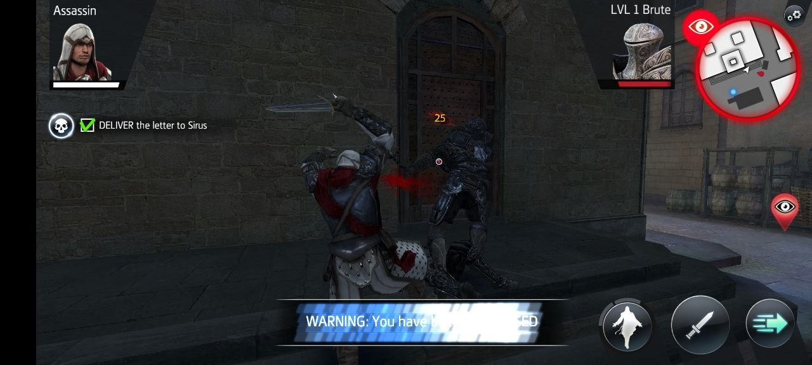
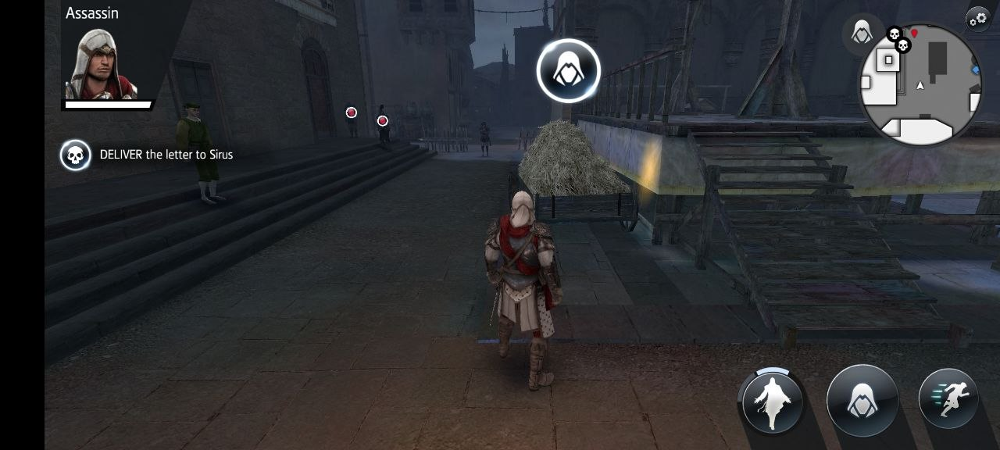

# Assassin's Creed Identity — Offline Rebuild & Server Emulation

<p align="center">
  
  
</p>

A comprehensive preservation and offline emulation project for **Assassin's Creed Identity (v2.8.2)** on Android. This project reverse-engineers the game's network architecture, emulates the decommissioned Ubisoft backend services, patches online DRM/discovery checks, and provides an on-device Companion Server with full level management and custom mission creation capabilities.

---

## 📌 Roadmap & Pending Tasks

The following major roadmap milestones are currently pending and under active planning / progress:

- [ ] **iOS / Mac build** *(considering standalone Windows / Linux builds as well)*
- [ ] **64-bit processor converter / translator** so it can run directly on pure 64-bit devices (Google Pixel 7/8/9, Snapdragon 8 Gen 3/4) without VM containers
- [ ] **Fix & improve custom mission script** (need some improvement, currently in progress)
- [ ] **Create Ubisoft community campaign / petition** so they can officially relaunch or remaster the game

---

## Table of Contents
1. [Roadmap & Pending Tasks](#-roadmap--pending-tasks)
2. [Project Overview](#project-overview)
3. [Reverse Engineering & Architecture](#reverse-engineering--architecture)
4. [How the Online Bypasses Work](#how-the-online-bypasses-work)
   - [1. Discovery & Network Redirection](#1-discovery--network-redirection)
   - [2. Protocol Buffers & Server Emulation](#2-protocol-buffers--server-emulation)
   - [3. CDN Asset & Cache Replication](#3-cdn-asset--cache-replication)
   - [4. ColorOS / Hans Background Freezer Immunity](#4-coloros--hans-background-freezer-immunity)
   - [5. Mission Progression & Lock Bypass](#5-mission-progression--lock-bypass)
   - [6. Firenze Spawn Collision Fix](#6-firenze-spawn-collision-fix)
5. [Companion Server Features](#companion-server-features)
   - [Authentic AC Launcher Icon](#authentic-ac-launcher-icon)
   - [80/20 Server Status & Instant Toggle](#8020-server-status--instant-toggle)
   - [Direct Game Launcher](#direct-game-launcher)
   - [Game Access & Level Progression Manager](#game-access--level-progression-manager)
   - [Custom Mission Creator & Uploader](#custom-mission-creator--uploader)
6. [Installation & Setup](#installation--setup)
   - [Single-Device Offline Play (Recommended)](#single-device-offline-play-recommended)
   - [PC Host Mode (Alternative)](#pc-host-mode-alternative)
7. [Custom Missions & Level Creation](#custom-missions--level-creation)

---

## Project Overview

Assassin's Creed Identity was originally designed as an always-online mobile action RPG powered by Unity. When Ubisoft decommissioned the official servers, the client became permanently stuck on initial connection checks, rendering the game completely unplayable.

This project delivers:
- **`ACIdentity_Game.apk`**: Patched game client redirected to query `127.0.0.1:8080` directly on the Android device.
- **`ACIdentity_CompanionServer.apk`**: Lightweight, battery-efficient Flutter + native Android service that runs locally in the background, serving discovery, authentication, catalog statics, CDN cache files, and mission payloads.
- **`AcierOfflineServer`**: .NET offline server implementation for Windows/macOS/Linux capable of exporting static payloads, serving game clients, and authoring campaign databases.
- **Full Campaign Unlocker & Level Manager**: Built into the companion app, enabling one-click progression unlocks, resets, and custom mission injection.

---

## Reverse Engineering & Architecture

### Client-Server Architecture

```
┌────────────────────────────────────────────────────────┐
│             Android Device (Single Device)             │
│                                                        │
│  ┌─────────────────────────┐                           │
│  │ Assassin's Creed        │                           │
│  │ Identity (Unity C#)     │                           │
│  └────────────┬────────────┘                           │
│               │ HTTP (Protobuf / Octet-Stream)         │
│               ▼                                        │
│  ┌─────────────────────────┐   Local CDN Cache         │
│  │ AC Identity Server App  │ ◄───────────────────────┐ │
│  │ (Dart + Foreground Svc) │                         │ │
│  └────────────┬────────────┘   /sdcard/Android/data/ │ │
│               │ LocalStorage   com.ubisoft.../cache  │ │
│               ▼                                        │
│  ┌─────────────────────────┐                           │
│  │ localstorage.json       │                           │
│  │ (Progression & Ents)    │                           │
│  └─────────────────────────┘                           │
└────────────────────────────────────────────────────────┘
```

The game relies on two communication layers:
1. **`AcierNetwork` (Protocol Buffers via HTTP POST)**:
   - Client sends binary Protobuf envelopes prefixed with a 2-byte opcode identifier (e.g., `0xE2 0x2B` for `CheckVersion`, `0xDA 0x25` for `GetStatics`, `0xB2 0x06` for `AuthAccount`, `0xC2 0x0C` for `OpenMission`, `0xCA 0x0C` for `EndMission`).
2. **CDN Static Storage (HTTP GET)**:
   - Requests assets under `/cdn/ACID_2.8.2_373/<asset_path>`. The client downloads `GameDB`, XML localization dictionaries, and Unity3D asset bundles mapped by 128-bit GUIDs in `catalogue.bin`.

---

## How the Online Bypasses Work

### 1. Discovery & Network Redirection
- **Original Behavior**: The game made DNS requests to Ubisoft discovery servers (`public-ubiservices.ubi.com`, etc.) to obtain environment URLs and access tokens.
- **Bypass**: The IL bytecode of `AcierNetwork.dll` was decompiled and patched to route all discovery, authentication, and CDN requests directly to `http://127.0.0.1:8080/`.

### 2. Protocol Buffers & Server Emulation
- Using decompiled schema structures from `AcierProtocol.dll`, the server synthesizes legitimate binary Protobuf responses:
  - **`CheckVersion`**: Responds that version `2.8.2_372` is up to date.
  - **`AuthAccount`**: Generates an offline player profile (`Berserker` class, level 1+, coins, inventory, and granted entitlements).
  - **`GetStatics` (`GameDB`)**: Serializes full catalogue definitions, weapon blueprints, skills, and campaign mission catalogs.
  - **`OpenMission` / `EndMission`**: Delivers mission parameters (target counts, coordinates, objectives, and completion rewards).

### 3. CDN Asset & Cache Replication
- The original CDN contained ~103 asset bundles (textures, audio, locales, models).
- The companion server uses a localized `catalogue.json` manifest. When the game requests a CDN asset, the server maps the URL to the corresponding cache GUID and serves it directly from `/sdcard/Android/data/com.ubisoft.assassinscreed.identity/files/cache/`, decompressing zlib bundles transparently when required.

### 4. ColorOS / Hans Background Freezer Immunity
- **The Problem**: Aggressive Android battery managers (notably OPPO/Realme `OplusHansManager`) monitor background processes. When the user switched from the companion server into the 3D game, the system froze the server process in `cgroup freezer`, causing the game to hang on mission start.
- **The Fix**: The companion app implements a persistent Android Foreground Service with `FOREGROUND_SERVICE_MEDIA_PLAYBACK` and streams continuous silent PCM audio through `AudioTrack`. `OplusHansManager` classifies the server with `audioFocus` importance, rejecting all freeze transitions (`cannot transition from R to M, importance=audioFocus`).

### 5. Mission Progression & Lock Bypass
- **The Problem**: Story missions appeared locked (`[🔒]`) or failed to unlock upon completion.
- **Root Cause**: The client checks `localStorage.json` for:
  ```csharp
  IsUnlocked = missionProgressData != null && missionProgressData.WasUnlockShown && Singleton<StateManager>.Instance.ProfileManager.EntitlementManager.HasEntitlements(MissionInfo.reqEntitlements);
  ```
- **The Fix**:
  1. Removed `reqEntitlements` prerequisites from the server's campaign catalogue.
  2. Implemented `Game Access & Level Manager` in the server app, allowing players to instantly toggle missions as unlocked/completed or synchronize the complete entitlement set into `localstorage.json`.

### 6. Firenze Spawn Collision Fix
- **The Problem**: In *Vengeful Eyes* (`story_crows_03`), *Burning Pages* (`story_crows_07`), and *A Dangerous Trade* (`story_crows_09`), player spawn coordinates (`-90, 10`) placed the assassin inside solid building meshes in Florence, locking movement.
- **The Fix**: Relocated player spawns to open cobblestone plazas in front of Palazzo Vecchio (`playerX = -6.0f, playerY = 0.5f, playerZ = -6.0f`).

---

## Companion Server Features

### Distinct AC Animus Companion Server Icon
To avoid home screen confusion with the main game app (which features the red hood assassin portrait), the Companion Server features a dedicated, authentic **Animus Server Icon**:
- Deep obsidian and carbon navy squircle background with electric cyan (`#00E5FF`) tech matrix lines and an Animus pulse ring.
- Centered glowing silver-cyan Assassin's Creed insignia with 3D metallic blade beveling.
- Distinct bottom **SERVER** badge with a live neon-green indicator dot.
- High-resolution rendering across all Android mipmap densities (`mdpi` 48px, `hdpi` 72px, `xhdpi` 96px, `xxhdpi` 144px, `xxxhdpi` 192px).

### 80/20 Server Status & Instant Toggle
- The top header provides an 80% width status card displaying live server health (`SERVER RUNNING` / `http://127.0.0.1:8080`).
- The 20% right corner features an instant toggle switch to start or halt the offline server with one tap.
- **True Background Termination**: When toggled OFF, the app cleanly halts the Android Foreground Service, releases wake locks, terminates the silent audio playback engine, and removes the persistent system notification. When toggled ON, the background service and server listener restart immediately.

### Direct Game Launcher
- Tapping **"Launch Game"** executes an explicit Android activity launcher intent (`packageManager.getLaunchIntentForPackage` and `BridgeActivity` with `FLAG_ACTIVITY_NEW_TASK or FLAG_ACTIVITY_RESET_TASK_IF_NEEDED`), launching the game reliably without returning to the home screen.

### Game Access & Dynamic Mission Progression Manager
Accessible via the **"Missions & Unlocks"** button:
- **Dynamic Protobuf Auth Filtering**: The server dynamically compiles and serves user entitlements in real time.
- **Story Progression Mode (Natural Unlocks)**:
  - Tapping **"Reset All"** resets story progress so that only *VR Training: Movement & Eagle Vision* (`story_tutorial_01`) is available.
  - Future missions remain locked until earlier missions are completed.
  - As you finish missions in-game, the Companion Server automatically captures `EndMissionRequest`, grants completion rewards, unlocks the next mission, and advances campaigns.
- **Sandbox Mode (Unlock All)**:
  - Tapping **"Unlock All"** grants all story reward entitlements and unlocks all 24 missions across all campaigns (*Montreal VR Training*, *Italy - A Murder of Crows*, *Forlì - A Crimson Sunset*, and *Bonus Contracts*).
- **Manual Granular Control**:
  - Individually toggle any mission's **Unlocked** or **Completed** state.

### Download Skill & AI Mission Guide (Direct On-Device)
- In the **Missions & Unlocks** screen, tap the **Download Skill & AI Guide** icon (`↓` in the top AppBar).
- Exports the autonomous mission generation assets directly into your phone's public storage:
  - `/sdcard/Download/ACIdentity_Mission_Skill/SKILL.md`
  - `/sdcard/Download/ACIdentity_Mission_Skill/CUSTOM_MISSION_SPEC.md`
  - `/sdcard/Download/ACIdentity_Mission_Skill/sample_mission.json`
- Displays step-by-step instructions and a **"Copy AI Prompt to Clipboard"** button. Paste the prompt directly into ChatGPT, Claude, Gemini, or any coding agent to instantly generate custom missions!

### Custom Mission Creator & File Uploader
- In the **Missions & Unlocks** screen, tap the **Upload / Pick File** icon (`↑` in the top AppBar).
- **Pick File from Device**: Tap **"Pick Mission File (.json or .bin)"** to browse your device files (e.g. from `/sdcard/Download/`).
  - **JSON files**: Automatically parsed, extracting title, region, atmosphere, player spawn, and objectives, registering the custom mission and unlocking it immediately.
  - **Compiled Binary files (`openMission_<mid>.bin`)**: Stored into `custom_missions/`, immediately unlocking the mission in your game state.
- **Manual Entry**: Or fill out the built-in form (Mission ID, Title, Region, Mood, Objective) and tap **Save & Register**.

---

## Installation & Setup

### Single-Device Offline Play (Recommended)

1. **Install Both APKs**:
   ```bash
   adb install -r AC_Identity_Offline_Release/ACIdentity_CompanionServer.apk
   adb install -r AC_Identity_Offline_Release/ACIdentity_Game.apk
   ```

2. **Copy Game Cache**:
   Ensure game cache assets are located in:
   `/sdcard/Android/data/com.ubisoft.assassinscreed.identity/files/cache/`

3. **Launch & Play**:
   - Open **AC Identity Server**. Ensure the status shows `SERVER RUNNING` (green).
   - Tap **"Open Assassin's Creed Identity"**.
   - Enjoy the full offline campaign!

---

## Custom Missions & Level Creation

### 1. The 4-Tab Server Companion Interface
The **AC Identity Server** app now features a 4-tab mission management interface:
- **Campaign**: Official story progression (Montreal VR, Italy, Forlì, Contracts) with individual and bulk unlock/reset switches.
- **Custom: Mission**: Dedicated hub for all user-created and AI-generated missions. Uploaded missions appear here by default with `ACTIVE IN GAME` badges, instant activation, and deletion controls.
- **Upload**: Minimal, clean upload screen featuring only `Mission ID:`, `Mission Title:`, and `Upload File` button.
- **Guide & Assets**: Comprehensive encyclopedia of game assets and interactive AI prompt guide with direct buttons to **Download Package** (saved to Downloads folder) and **Share / Open Package**.

### 2. Dual-Slot In-Game Playability (Contracts & Italy)
Custom missions are automatically compiled into Google Protobuf binaries on-device and mapped to two slots simultaneously:
1. **Contracts (`story_0015`)**: Tap **Contracts** in the game's main menu.
2. **Italy — A Murder of Crows (`story_crows_01`)**: Tap **Italy** on the Animus map and enter Mission 1.
Your custom mission loads and plays immediately in either location!

### 3. Creating Missions with AI (ChatGPT, Claude, Gemini)
1. In the **Guide & Assets** tab of the server app (or from this repository), tap **Download Package** to get:
   - `SKILL.md`: The autonomous mission creator agent skill.
   - `INSTRUCTIONS.md`: Progressive interview protocol guiding the AI step-by-step.
   - `AC_IDENTITY_ASSETS_GUIDE.pdf`: 3-page printable encyclopedia of all historical maps, characters, animals, props, and rooftop tailing mechanics.
   - `sample_mission.json`: Working template.
2. Upload `SKILL.md` and `INSTRUCTIONS.md` to your AI chat.
3. The AI will interview you step-by-step:
   - **Slot**: Contracts, Italy, or Both.
   - **Location**: Firenze Palazzo, Firenze Santa Croce, Roma Colosseo, Monteriggioni, or Forlì.
   - **Mood / Time**: Daytime, Nighttime, Dusk, or Foggy.
   - **Objective**:
     - *Assassinate / Eliminate*: Borgia Captains, Templars, Spies.
     - *Protect / Escort*: King, Duke, Maid, Courtesan, Courier.
     - *Tail / Follow / Spy*: Rooftop and street pursuit (maintaining 15m–40m distance, leaping beams, stealth blending, or silently assassinating alerted guards before alarms sound).
   - **Cast & Characters**: Nobles, Kings, Maids, Crossbowmen, Brutes, Agile Scouts.
4. The AI outputs a verified, collision-safe `mission.json`.
5. In the Companion App -> **Upload** tab -> select your file -> Play in AC Identity!

### 4. Compiling via CLI
You can also compile custom missions to binary `.bin` files on your computer using `AcierOfflineServer`:
```bash
dotnet run --project offline/AcierOfflineServer -- --build-mission <path_to_mission.json> <output_dir>
```
This produces `openMission_<mid>.bin`, `getMissionInfo_<mid>.bin`, and `endMission_<mid>.bin` which can be uploaded directly to the companion server or placed into `/sdcard/ACIdentity/custom_missions/`.
